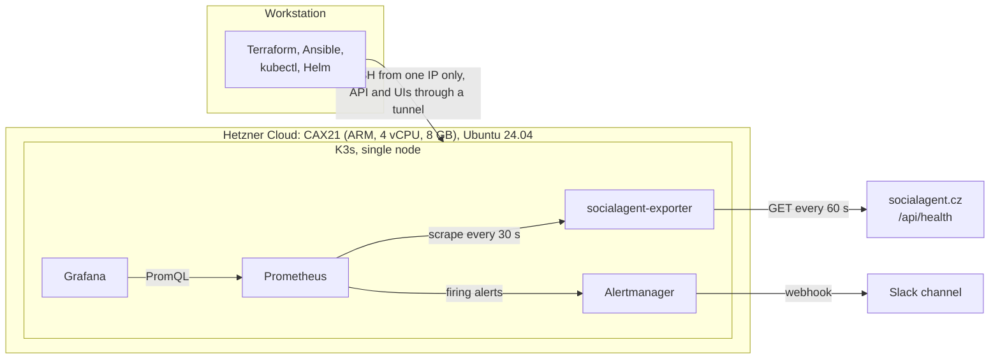

# SocialAgent DevOps lab

[](https://github.com/tomajzcz/socialagent-devops-lab/actions/workflows/validate.yml)

A small but complete monitoring setup, built as a seven-day lab: a Hetzner
server created with Terraform and hardened with Ansible, single-node K3s with
kube-prometheus-stack, and a custom exporter that watches the public health
endpoint of SocialAgent, a production web app. Alerts go to Slack.

The lab only *reads* production: one GET on `/api/health` per minute. No
database access, no credentials, no jobs triggered.

## Architecture



The whole stack uses about 2 GiB of the node's memory.

## What is where

| Path | What it does |
|---|---|
| `terraform/` | Server, SSH key and firewall in Hetzner Cloud. The firewall lets in only SSH and ping, only from one /32. Provider pinned, state kept locally. |
| `ansible/` | `hardening` role (admin user, key-only SSH, unattended upgrades with reboot) and `k3s` role (pinned version, checksum-verified installer, Secrets encrypted at rest). |
| `exporter/` | The exporter (FastAPI, httpx, prometheus_client) and its image: digest-pinned base, non-root, read-only root filesystem. |
| `k8s/exporter/` | Deployment, Service, ServiceMonitor, alert rules and the Grafana dashboard as code. The namespace enforces the `restricted` Pod Security Standard. |
| `k8s/monitoring/` | kube-prometheus-stack values: K3s-specific settings, storage and retention, routing to Slack. |
| `k8s/drill/` | A fake health endpoint inside the cluster, for testing the alerts end to end. |
| `scripts/` | `check-alerting.sh`: unit tests of the alert rules and of the Alertmanager routing. `lab-tunnel.sh`: one background SSH connection to the API and the monitoring UIs. |
| `.github/workflows/` | CI that validates everything on every push and pull request. It never deploys. |

The READMEs in `ansible/`, `exporter/`, `k8s/monitoring/` and `k8s/drill/`
have the details and the reasons behind them.

## Security boundaries

- **Nothing is published.** The Hetzner firewall lets in only SSH and ping,
  from one address. The Kubernetes API, Prometheus, Grafana and Alertmanager
  are reached through an SSH tunnel that listens only on the workstation's
  localhost.
- **No secrets in Git.** The Hetzner token, the Grafana password and the Slack
  webhook live in the macOS Keychain. The cluster gets them as Secrets created
  from stdin, and K3s encrypts Secrets at rest.
- **Everything is pinned:** the Terraform provider, the K3s version and the
  installer checksum, the Helm chart version, images and tools by digest,
  GitHub Actions by commit SHA.
- **CI is read-only.** Its token can only read the repository, and checkout
  does not keep it on disk.
- **Production is protected from the lab.** The exporter refuses probe
  intervals below 30 seconds, because every call to `/api/health` runs
  database queries in production.

## Alerting

Five rules in `k8s/exporter/prometheusrule.yaml`: database down, app
unreachable, cron jobs degraded, exporter stuck, exporter not scraped. The
chart adds its rules for the cluster itself. Warning and critical alerts go to
Slack, with a second message when they resolve. From a real outage to a Slack
message takes 3 to 5 minutes.

The rules have unit tests (promtool) and the routing has tests (amtool), both
run in CI. The whole chain was tested with an alert drill against the fake
endpoint in `k8s/drill/`: `SocialAgentDown` and `SocialAgentUnreachable`
fired and resolved in Slack as expected.

## Build order

On a fresh setup, run from the repository root after
`cp .env.example .env`, filling it in and `source .env`:

1. **Server:** `cd terraform && terraform init && terraform apply`, then put
   `server_ipv4` from the output into `LAB_SERVER_IP` in `.env`.
2. **Hardening and K3s:** `cd ansible && ansible-playbook site.yml`. The very
   first run connects as root, see `ansible/README.md`.
3. **Tunnel** to the Kubernetes API, keep it open:
   `ssh -N -L 6443:127.0.0.1:6443 <admin user>@"$LAB_SERVER_IP"`.
4. **Monitoring:** namespace, Secrets and the Helm chart, see
   `k8s/monitoring/README.md`.
5. **Exporter:** `kubectl apply -k k8s/exporter`.

Day to day, `scripts/lab-tunnel.sh up` opens one SSH connection in the
background that carries the Kubernetes API (6443), Prometheus (9090), Grafana
(3000) and Alertmanager (9093); `status` checks them and `down` closes it.

## Checks

CI (`.github/workflows/validate.yml`) runs on every push and pull request. The
same checks on the workstation:

```bash
(cd terraform && terraform fmt -check -recursive && terraform validate)
(cd ansible && ansible-lint)
kubectl kustomize k8s/exporter \
  | kubeconform -strict -summary -kubernetes-version 1.37.2 -skip ServiceMonitor,PrometheusRule -
./scripts/check-alerting.sh
docker build --tag socialagent-exporter:dev exporter
```

Locally, kubeconform skips the two CRDs. CI validates them too, against
schemas from the datreeio CRDs catalog, and also validates the whole
kube-prometheus-stack chart rendered with `k8s/monitoring/values.yaml`.

## Next steps

- Send `Watchdog` to an external dead man's switch, so that a dead monitoring
  stack is noticed too.
- Move the Terraform state to a remote backend with locking. Today it is a
  local file with a manual backup.
- GitOps (Argo CD or Flux) instead of `kubectl apply` and `helm upgrade` from
  the workstation, so the cluster follows Git by itself.
- Build, sign and push the exporter image from CI instead of by hand.
- For production rather than a lab: more than one node, and long-term metrics
  storage such as Thanos or Mimir.
